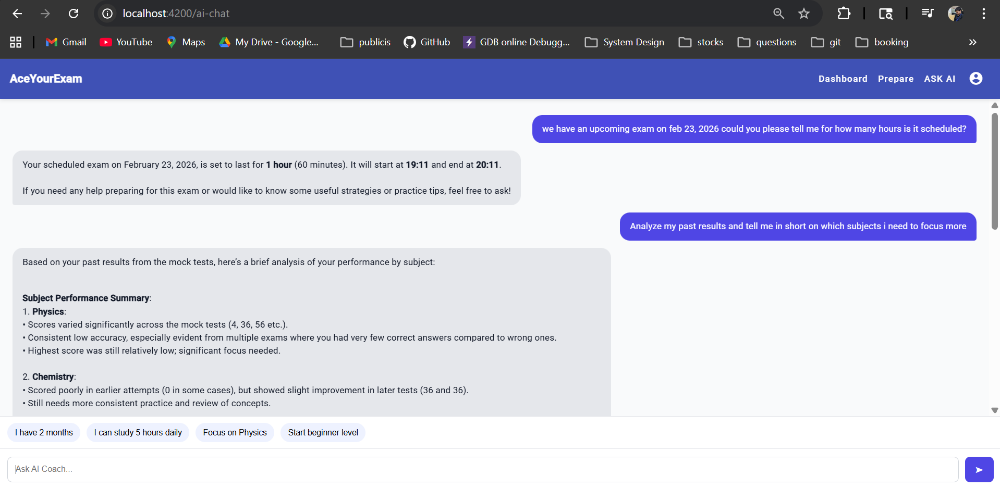

# 🤖 AI Coach (LLM Agent) – AceYourExam

AceYourExam now includes an **AI-powered coaching assistant** that acts as a **personal mentor for students**.

This feature leverages **LLM + Tool Calling + Backend APIs** to provide:

- Personalized insights
- Real-time performance analysis
- Smart study recommendations
- Context-aware conversations

---

## 🚀 Key Capabilities

### 🧠 1. Conversational AI Coach

Students can ask natural questions like:

- “Analyze my past performance”
- “What are my weak subjects?”
- “Give me a study plan”
- “Suggest questions to practice”

The AI responds like a **real mentor**, not just raw data.

---

### 🔧 2. Tool Calling (Function-Based AI)

The agent intelligently calls backend APIs:

| Tool                   | Purpose                      |
| ---------------------- | ---------------------------- |
| `get_student_results`  | Fetch past exam results      |
| `get_attempt_details`  | Deep analysis of attempts    |
| `search_questions`     | Recommend practice questions |
| `supported_exam_types` | Show supported exams         |

👉 No hardcoding — AI decides dynamically.

---

### 🔐 3. Secure Personalization (JWT Based)

- JWT token passed from Angular → FastAPI → Backend
- User identity extracted securely
- Supports queries like:

✅ “Show my results”  
❌ No need to expose userId manually

---

### 🧩 4. Context-Aware Conversations

The system maintains **chat history (last few messages)**:

- Follow-up questions supported
- Multi-step conversations enabled

Example:

User: “Analyze my performance”  
User: “Focus only on Physics”  
→ AI understands context

---

### ⚡ 5. Smart Suggestions (Dynamic UI)

After every response, AI generates contextual suggestions:

- “Analyze weak areas”
- “Give me a study plan”
- “Focus on Physics”
- “Start beginner level”

This creates a **guided learning experience**.

---

### 🖥️ 6. Full Chat UI (Angular)

- ChatGPT-like interface
- User / AI message bubbles
- Sticky input box
- Real-time suggestions
- Auto-scroll behavior

---

## 📸 AI Assistant

| AI Chat Interface                |
| -------------------------------- |
|  |

---

## 🏗️ AI Architecture

Angular UI  
↓  
FastAPI (AI Agent Layer)  
↓  
OpenAI (LLM + Tool Calling)  
↓  
Spring Boot APIs  
↓  
PostgreSQL

---

## 🔁 Request Flow

User Query  
↓  
AI Agent (LLM decides tool)  
↓  
Backend API call  
↓  
Tool response  
↓  
LLM generates final answer  
↓  
UI renders response + suggestions

---

## 🧠 Why This is Powerful

- Not just a chatbot → **Decision-making AI**
- Real backend integration → **No hallucination**
- Personalized coaching → **User-specific insights**
- Extensible → Add more tools anytime

---
